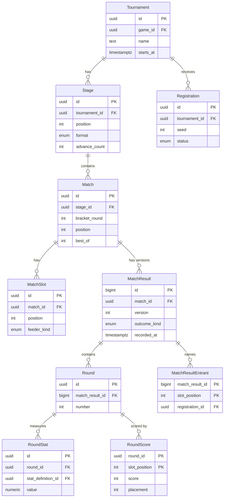
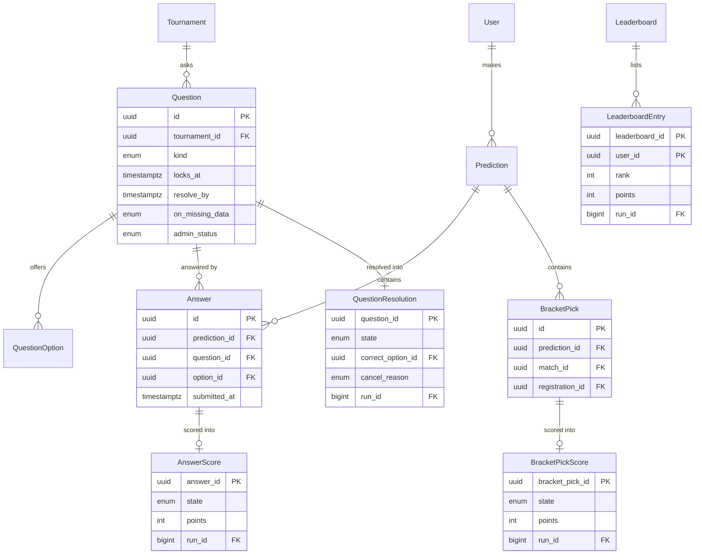
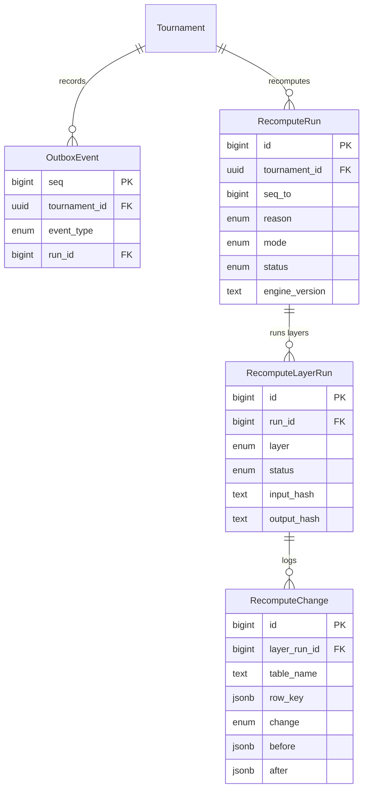
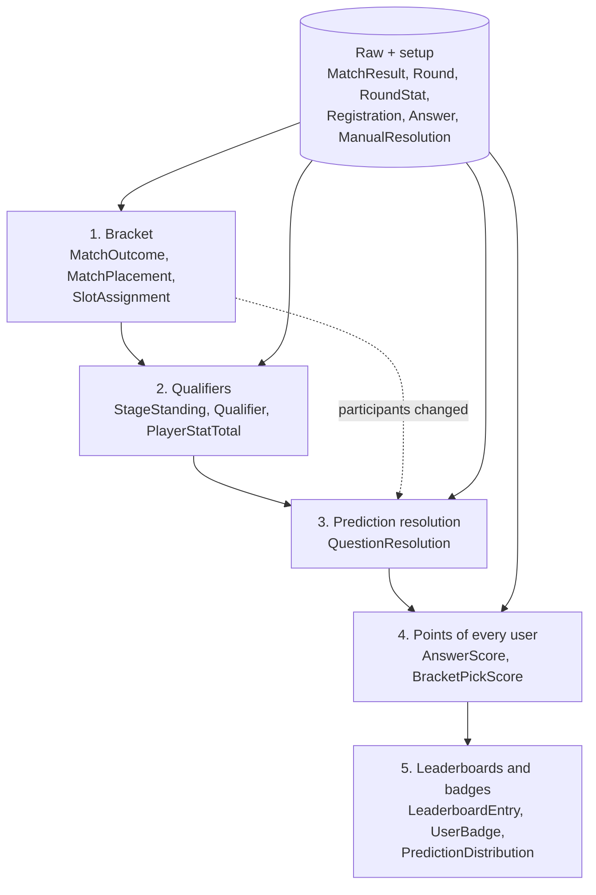
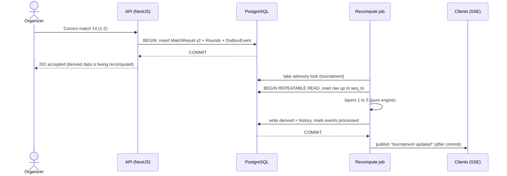
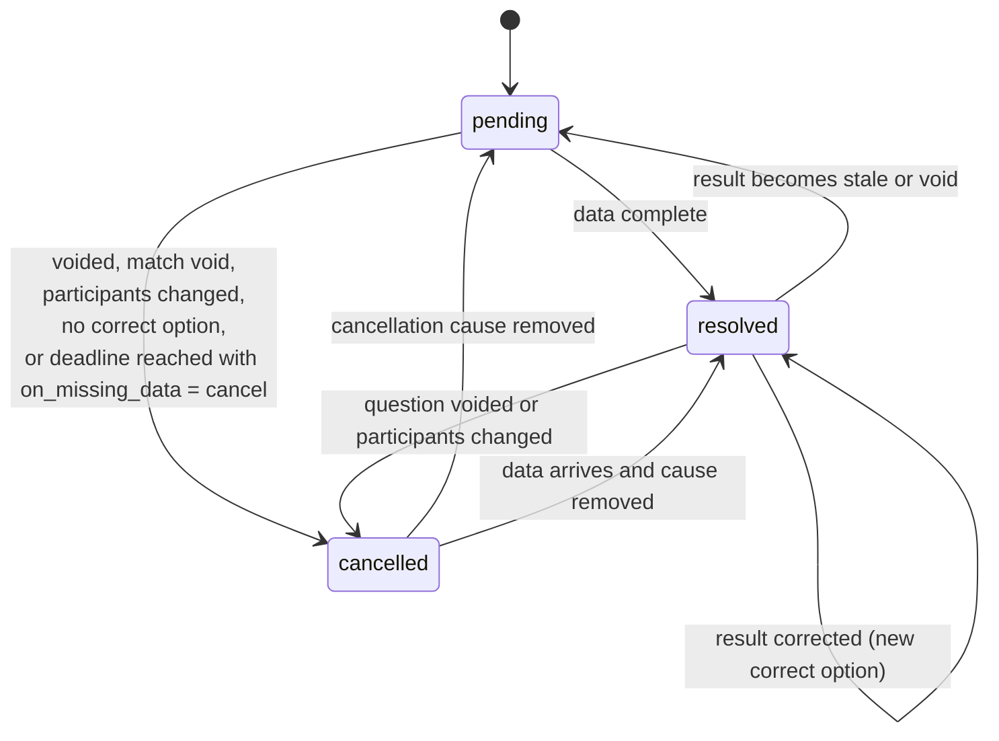

# Data model

- Status: proposed, version 2 (ticket 9, sprint 1), checked against the full subject
- Subject reference: 02-G, 03-C "Modèle de données"
- Related: ADR 0001 (global stack: PostgreSQL, Prisma, NestJS, SSE)

## 1. Goal and principles

The database is designed so that **raw results are the only source of truth**. Everything else (bracket progression, qualifiers, prediction points, leaderboards) can be thrown away and rebuilt from the raw data.

Five rules drive every choice below.

1. **Four kinds of data.** Every table is exactly one of: *setup* (configuration chosen by an organizer), *raw* (facts entered or imported), *derived* (computed, never edited), *history* (records of what the system did).
2. **Raw results are versioned and append-only.** A correction never edits a row. It adds a new version of the result. The previous version stays, so any past state can be explained.
3. **Derived data is never edited by hand.** Only the recalculation job writes to derived tables. The database enforces this (section 6.7), not just the application code.
4. **Recalculation is a pure function.** Same raw data, same rules, same engine version give the same derived data, always. A full rebuild and a chain of incremental updates must end in the same state.
5. **Missing data is a state, not an error.** A question whose data never arrives is cancelled, and the cancellation is itself derived and reversible.

## 2. Vocabulary

| Term | Meaning |
| --- | --- |
| Round (*manche*) | One game played inside a match (for example game 2 of a best-of-3). Entity `Round`. |
| Bracket round | A column of the bracket (quarter-finals, semi-finals). Always written `bracket_round` in fields to avoid confusion with `Round`. |
| Registration (*inscription*) | A team or a player entered in a tournament. It is the **participant** of every match, question and standing. |
| Slot | One place in a match: two in a duel, N in a free-for-all (FFA). Its content (which registration) is derived. |
| Administrator | The only profile that creates content, as the subject says. This document often writes "organizer" for the administrator who owns a tournament. |
| Result version | One row of `MatchResult`. The current result of a match is its highest version. |
| Layer | One step of the cascade (bracket, qualifiers, resolution, points, leaderboards). |

## 3. Raw, setup, derived, history

| Entity | Kind | Why |
| --- | --- | --- |
| Game | setup | Rules of a game title (team size, draws allowed). |
| StatDefinition | setup | Which statistics exist for a game. |
| Source | setup | Where data comes from (start.gg, manual entry, CSV). |
| User | setup | Account and role. |
| Tournament | setup | Event configuration. |
| Stage | setup | A phase and its format (single elimination, Swiss, pools). |
| Team | setup | A team identity. |
| Player | setup | A player identity. |
| TeamMember | setup | Who plays in which team. |
| Match | setup | A planned match and its place in a stage. |
| MatchSlot | setup | The rule that fills a slot (seed, winner of match X, rank in stage Y). |
| Question | setup | A prediction question and its resolution rule. |
| QuestionOption | setup | An allowed answer. |
| ScoringRule | setup | How many points a correct answer gives. |
| Group | setup | A private prediction group. |
| GroupMember | setup | Membership of a group. |
| Leaderboard | setup | Definition of a ranking (scope and tie-break order). |
| Season | setup | A group of tournaments ranked together. |
| Pool | setup | A pool (*poule*) inside a stage. |
| PoolMember | setup | Which registration sits in which pool. |
| Station | setup | A station, table or field where matches are played. |
| CustomFieldDefinition | setup | An extra registration field defined by the administrator. |
| TeamInvite | setup | An invitation link to join a team. |
| QuestionTemplate | setup | A question model (most chosen, best on a statistic...). |
| Badge | setup | A badge or title and its award rule. |
| **SourceImport** | **raw** | One import run from a source. |
| **SourceRecord** | **raw** | The payload exactly as received, kept for replay. |
| **Registration** | **raw** | A team or player entered in a tournament, with its seed. |
| **MatchResult** | **raw** | One version of a match result. |
| **Round** | **raw** | One game of a match result version, with its scores. |
| **RoundStat** | **raw** | One statistic value measured in a round. |
| **Prediction** | **raw** | A user's prediction sheet for a tournament. |
| **Answer** | **raw** | A user's answer to a question. |
| **ManualResolution** | **raw** | An organizer's decision of the correct answer for a manual question. |
| **RegistrationMember** | **raw** | The roster (starters and substitutes) of a registration. |
| **MatchResultEntrant** | **raw** | Who took part in each slot of a result version. |
| **RoundScore** | **raw** | The score or placement of each slot in a round. |
| **ResultDeclaration** | **raw** | A score declared by a participant, awaiting confirmation. |
| **Dispute** | **raw** | A contested result, with evidence, and the administrator's decision. |
| **BracketPick** | **raw** | A user's pick of the winner of one bracket match (full-bracket prediction). |
| *SlotAssignment* | derived | Which registration sits in each slot. |
| *MatchOutcome* | derived | Winner, loser and state of each match. |
| *StageStanding* | derived | Ranking inside a stage. |
| *Qualifier* | derived | Who advances from a stage and where. |
| *PlayerStatTotal* | derived | Statistics summed over the tournament. |
| *QuestionResolution* | derived | Correct answer of a question, or why it is cancelled. |
| *AnswerScore* | derived | Points earned by one answer. |
| *LeaderboardEntry* | derived | Rank and points of a user in a leaderboard. |
| *MatchPlacement* | derived | Placement and points of each participant in a match. |
| *BracketPickScore* | derived | Points earned by one bracket pick. |
| *PredictionDistribution* | derived | Share of the public that chose each option. |
| *UserBadge* | derived | Badges and titles earned by a user. |
| OutboxEvent | history | Every raw change, in order. It triggers recalculation. |
| RecomputeRun | history | One execution of the cascade. |
| RecomputeLayerRun | history | One layer of one run, with hashes and counters. |
| RecomputeChange | history | Row-level before/after of what a run changed. |
| AuditLog | history | Who changed which mutable raw or setup row. |

### 3.1 Mutability of raw tables

Not all raw data can be append-only. This table says what is allowed, so nobody has to guess.

| Table | Update in place? | How changes are tracked |
| --- | --- | --- |
| MatchResult, MatchResultEntrant, Round, RoundScore, RoundStat | Never. Database trigger rejects UPDATE and DELETE. | New version of `MatchResult`. |
| SourceImport, SourceRecord | Records never. An import row only moves forward (previewed, running, then succeeded or failed, possibly undone). | New import. |
| ManualResolution, ResultDeclaration | Never. | New version, or a new declaration. |
| Registration | Yes (status, seed). | `AuditLog` and an `OutboxEvent`. |
| Prediction, Answer, BracketPick | Yes, until the question or the stage locks. After that, never. | `AuditLog`. |
| Dispute | Only its status and decision. | `AuditLog`. |
| RegistrationMember | Yes, until check-in closes. | `AuditLog`. |

Consequence: results can be replayed **as of any date** (raw versions are immutable and stamped with `recorded_at`). Registrations and answers can only be replayed in their current state, with the history in `AuditLog`. This limit is accepted for version 1.

## 4. Diagrams

All diagrams are Mermaid, so they render on GitHub.

### 4.1 Overview

Raw tables are the root of everything. Arrows from derived tables always point back to raw or setup tables, never the other way.

```mermaid
erDiagram
  Game ||--o{ StatDefinition : defines
  Game ||--o{ Tournament : "is played in"
  Tournament ||--o{ Stage : has
  Stage ||--o{ Match : contains
  Match ||--o{ MatchSlot : has
  Tournament ||--o{ Registration : receives
  Team |o--o{ Registration : "enters as"
  Player |o--o{ Registration : "enters as"
  Team ||--o{ TeamMember : has
  Player ||--o{ TeamMember : "plays in"
  User |o--o{ Player : "is linked to"
  Source ||--o{ SourceImport : runs
  SourceImport ||--o{ SourceRecord : receives
  Source ||--o{ Registration : "originates"
  Source ||--o{ MatchResult : "originates"
  Match ||--o{ MatchResult : "has versions"
  MatchResult ||--o{ Round : contains
  Round ||--o{ RoundStat : measures
  StatDefinition ||--o{ RoundStat : "typed by"
  Registration ||--o{ RoundStat : "belongs to"
  Tournament ||--o{ Question : asks
  ScoringRule ||--o{ Question : scores
  Question ||--o{ QuestionOption : offers
  Question ||--o{ ManualResolution : "decided by"
  User ||--o{ Prediction : makes
  Tournament ||--o{ Prediction : receives
  Prediction ||--o{ Answer : contains
  Question ||--o{ Answer : "answered by"
  QuestionOption |o--o{ Answer : chosen
  User ||--o{ GroupMember : joins
  Group ||--o{ GroupMember : has
  Tournament |o--o{ Leaderboard : ranks
  Group |o--o{ Leaderboard : "scopes"
  MatchSlot ||--o| SlotAssignment : "resolved into"
  Match ||--o| MatchOutcome : "resolved into"
  MatchResult ||--o{ MatchOutcome : "is used by"
  Stage ||--o{ StageStanding : ranks
  Stage ||--o{ Qualifier : qualifies
  Tournament ||--o{ PlayerStatTotal : totals
  Question ||--o| QuestionResolution : "resolved into"
  Answer ||--o| AnswerScore : "scored into"
  Leaderboard ||--o{ LeaderboardEntry : lists
  User ||--o{ LeaderboardEntry : "appears in"
  Tournament ||--o{ OutboxEvent : records
  Tournament ||--o{ RecomputeRun : recomputes
  RecomputeRun ||--o{ RecomputeLayerRun : "runs layers"
  RecomputeLayerRun ||--o{ RecomputeChange : logs
  User |o--o{ AuditLog : acts
  Season |o--o{ Tournament : groups
  Season |o--o{ Leaderboard : scopes
  Stage ||--o{ Pool : splits
  Pool ||--o{ PoolMember : lists
  Registration ||--o{ PoolMember : "placed in"
  Pool |o--o{ Match : hosts
  Tournament ||--o{ Station : has
  Station |o--o{ Match : hosts
  Tournament ||--o{ CustomFieldDefinition : defines
  Team ||--o{ TeamInvite : issues
  Registration ||--o{ RegistrationMember : "lists roster"
  Player ||--o{ RegistrationMember : "plays as"
  MatchResult ||--o{ MatchResultEntrant : names
  Registration ||--o{ MatchResultEntrant : "takes part"
  Round ||--o{ RoundScore : "scored by"
  Match ||--o{ ResultDeclaration : "declared on"
  Match ||--o{ Dispute : "contested by"
  Dispute |o--o{ MatchResult : "settled by"
  QuestionTemplate ||--o{ Question : "instantiated as"
  Prediction ||--o{ BracketPick : contains
  Match ||--o{ BracketPick : "picked on"
  BracketPick ||--o| BracketPickScore : "scored into"
  Match ||--o{ MatchPlacement : ranks
  QuestionOption ||--o| PredictionDistribution : tallied
  Badge ||--o{ UserBadge : awarded
  User ||--o{ UserBadge : earns
```

### 4.2 Tournament structure and raw results

### 4.3 Predictions

### 4.4 Recalculation history

## 5. Field dictionary

Conventions:

- Table names are the entity names in `snake_case` (`MatchResult` is `match_result`).
- `id` is a `uuid` primary key unless the table says otherwise.
- Types: `uuid`, `text`, `int`, `bigint`, `numeric`, `bool`, `timestamptz`, `jsonb`, `enum` (a PostgreSQL enum, values listed).
- Times are stored in UTC.
- Every **derived** table also has `run_id bigint` (the `RecomputeRun` that last wrote the row) and `computed_at timestamptz`. They are not repeated below.
- Every **raw** table also has `recorded_at timestamptz` (server time of insertion). Not repeated below.

### 5.1 Setup

#### Game

| Field | Type | Meaning |
| --- | --- | --- |
| id | uuid | Primary key. |
| slug | text | Unique short name, for URLs. |
| name | text | Display name of the game. |
| participant_kind | enum | `team` or `player`: who registers. |
| max_team_size | int | Players per team, 1 for solo games. |
| draw_allowed | bool | Whether a round or a match can end in a draw. |
| external_ref | text | Identifier of the game at the source, if any. |

#### StatDefinition

| Field | Type | Meaning |
| --- | --- | --- |
| id | uuid | Primary key. |
| game_id | uuid | The game this statistic belongs to. |
| code | text | Stable machine name (`kills`). Unique with `game_id`. |
| label | text | Display name. |
| scope | enum | `player` or `team`: what the value measures. |
| value_kind | enum | `number`, or `choice` for a character, champion or map taken from a configurable list. |
| choices | jsonb | For `choice`: the allowed list, set by the administrator. |
| aggregation | enum | `sum`, `max` or `avg` for numbers, `mode` (most frequent) for choices. |
| unit | text | Unit shown to users, may be empty. |

#### Source

| Field | Type | Meaning |
| --- | --- | --- |
| id | uuid | Primary key. |
| kind | enum | `startgg`, `manual`, `csv`, `json`. |
| name | text | Display name (`start.gg`, `Saisie organisateur`). |
| config | jsonb | Non-secret settings. Tokens never go in the database. |

#### User

| Field | Type | Meaning |
| --- | --- | --- |
| id | uuid | Primary key. |
| email | text | Unique login. |
| display_name | text | Name shown in leaderboards. |
| is_synthetic | bool | Account generated by the simulator. The demo platform holds no real personal data. |
| role | enum | `admin`, `player`, `user` (the subject's spectator profile). Any signed-in user can predict, players included. |
| created_at | timestamptz | Account creation. |

#### Tournament

| Field | Type | Meaning |
| --- | --- | --- |
| id | uuid | Primary key. |
| game_id | uuid | Game played. |
| owner_user_id | uuid | Organizer who owns it. |
| name | text | Display name. |
| slug | text | Unique, for URLs. |
| lifecycle | enum | `draft`, `published`, `archived`. Whether it is live or finished is **derived** from matches, not stored. |
| starts_at | timestamptz | Planned start. |
| timezone | text | IANA time zone used for display. |
| description | text | Presentation text. |
| rules_text | text | The tournament rules (*règlement*). |
| visibility | enum | `public` or `invite_only`. |
| venue_mode | enum | `online`, `onsite`, `mixed`. |
| venue | text | Place, for onsite and mixed. |
| capacity | int | Number of places, null for unlimited. Registrations beyond it are waitlisted. |
| registration_mode | enum | `open` or `approval` (the administrator validates each one). |
| checkin_opens_at | timestamptz | Start of the check-in window. |
| checkin_closes_at | timestamptz | End of the check-in window. Absent registrations are replaced from the waitlist. |
| team_min_starters | int | Minimum starters in a team, 1 for solo. |
| team_max_starters | int | Maximum starters. |
| team_max_substitutes | int | Maximum substitutes. |
| origin | enum | `internal` or `imported`. |
| read_only | bool | True for imported tournaments: results come from the source and cannot be edited here. |
| is_template | bool | A template for recurring tournaments. |
| duplicated_from_id | uuid | Tournament or template this one was copied from. |
| season_id | uuid | Season it belongs to, null if none. |
| source_id | uuid | Source it was imported from, null if created by hand. |
| external_ref | text | Identifier at the source. |

#### Stage

| Field | Type | Meaning |
| --- | --- | --- |
| id | uuid | Primary key. |
| tournament_id | uuid | Parent tournament. |
| position | int | Order of the stage (1 is first). |
| name | text | Display name. |
| format | enum | `single_elim`, `double_elim`, `round_robin` (with pools when the stage has `Pool` rows), `swiss`, `ffa` (several participants per match, points by placement). |
| advance_count | int | How many registrations leave this stage, null for the last stage. |
| seeding_mode | enum | `manual` or `auto`. |
| prediction_mode | enum | `none`, `match_by_match`, `full_bracket`, `both`. Chosen by the administrator per stage. |
| prediction_locks_at | timestamptz | When full-bracket picks close. Null means the start of the stage's first match. |
| params | jsonb | Format settings: number of Swiss rounds, third-place match, best-of per round (BO1, BO3, BO5), points table (win, draw, loss, placement points in FFA), ordered tie-break rules (head to head, round difference, Buchholz). |

#### Team

| Field | Type | Meaning |
| --- | --- | --- |
| id | uuid | Primary key. |
| name | text | Team name. |
| tag | text | Short tag. |
| captain_player_id | uuid | The captain, who invites and manages the roster. |
| source_id | uuid | Source, null if created by hand. |
| external_ref | text | Identifier at the source. |

#### Player

| Field | Type | Meaning |
| --- | --- | --- |
| id | uuid | Primary key. |
| user_id | uuid | Linked account, null for players who never signed up. |
| handle | text | In-game name. |
| source_id | uuid | Source, null if created by hand. |
| external_ref | text | Identifier at the source. |

#### TeamMember

| Field | Type | Meaning |
| --- | --- | --- |
| team_id | uuid | Team. Primary key with `player_id` and `joined_on`. |
| player_id | uuid | Player. |
| joined_on | date | First day in the team. |
| left_on | date | Last day in the team, null if still a member. |
| is_substitute | bool | Substitute rather than starter. |
| role | text | Role in the team. |

#### Match

| Field | Type | Meaning |
| --- | --- | --- |
| id | uuid | Primary key. |
| stage_id | uuid | Stage it belongs to. |
| bracket_round | int | Column of the bracket (1 is the first). For Swiss, the Swiss round number. |
| position | int | Order inside the bracket round. Unique with `stage_id` and `bracket_round`. |
| label | text | Name shown to users (`Match 14`). |
| best_of | int | Maximum number of rounds (1, 3, 5). |
| scheduled_at | timestamptz | Planned start, null if unknown. |
| estimated_minutes | int | Estimated duration, null if unknown. |
| station_id | uuid | Station, table or field, null if none. |
| pool_id | uuid | Pool, for matches of a pool. |

#### MatchSlot

| Field | Type | Meaning |
| --- | --- | --- |
| id | uuid | Primary key. |
| match_id | uuid | Match. |
| position | int | 1 or 2 in a duel, 1 to N in an FFA. Unique with `match_id`. |
| feeder_kind | enum | How the slot is filled: `seed`, `match_winner`, `match_loser`, `stage_rank`, `bye`. |
| seed_number | int | For `seed`: the seed that goes here. |
| feeder_match_id | uuid | For `match_winner` and `match_loser`: the match it depends on. |
| feeder_stage_id | uuid | For `stage_rank`: the earlier stage. |
| feeder_pool_id | uuid | For `stage_rank`: the pool, for rules such as "first of pool A". Null if the stage has no pools. |
| feeder_rank | int | For `stage_rank`: the rank in that stage or pool. |

The slot says **where the participant comes from**. The participant itself is derived (`SlotAssignment`).

#### Question

| Field | Type | Meaning |
| --- | --- | --- |
| id | uuid | Primary key. |
| tournament_id | uuid | Tournament. |
| match_id | uuid | Match the question is about, null for tournament-wide questions. |
| stage_id | uuid | Stage the question is about, null if none. |
| template_id | uuid | Question template it was built from, null for a hand-written question. |
| kind | enum | `match_winner`, `match_score`, `most_chosen`, `stat_leader`, `number_total`, `ranking`, `yes_no`, `manual_choice`. Selects the resolver in the engine. The last six are the families of the subject (most chosen, best on a statistic, total or number, ranking, yes or no). |
| prompt | text | Text shown to users. |
| resolver_params | jsonb | Inputs of the resolver (which statistic, which thresholds). |
| scoring_rule_id | uuid | Scoring rule. |
| opens_at | timestamptz | Answers accepted from this time. |
| locks_at | timestamptz | Answers refused after this time. |
| resolve_by | timestamptz | Deadline for the data needed to resolve. |
| on_missing_data | enum | `wait` or `cancel`: what happens when `resolve_by` passes and data is still missing. |
| admin_status | enum | `active` or `voided`. `voided` is a decision of an organizer. |
| voided_by | uuid | User who voided it. |
| voided_reason | text | Why. Required when voided. |
| voided_at | timestamptz | When. |

`admin_status`, `voided_*` are **raw inputs** (a human decision). They are the only raw fields stored on a setup table, and changes are written to `AuditLog`.

#### QuestionOption

| Field | Type | Meaning |
| --- | --- | --- |
| id | uuid | Primary key. |
| question_id | uuid | Question. |
| position | int | Display order. |
| label | text | Text shown to users. |
| registration_id | uuid | For winner and qualifier questions: the participant this option stands for. |
| condition | jsonb | For statistic questions: the range that makes this option correct. |

#### ScoringRule

| Field | Type | Meaning |
| --- | --- | --- |
| id | uuid | Primary key. |
| tournament_id | uuid | Tournament. |
| code | text | Name (`match_winner_default`). |
| points_correct | int | Points for a correct answer. |
| params | jsonb | Extra rules: exact-score bonus, points that grow along the bracket (`round_points`), points per question kind. |
| version | int | Incremented when changed. Changing a rule triggers a full recalculation. |

#### Group

| Field | Type | Meaning |
| --- | --- | --- |
| id | uuid | Primary key. |
| name | text | Group name. |
| owner_user_id | uuid | Creator. |
| invite_code | text | Unique code to join. |

#### GroupMember

| Field | Type | Meaning |
| --- | --- | --- |
| group_id | uuid | Group. Primary key with `user_id`. |
| user_id | uuid | Member. |
| joined_at | timestamptz | When they joined. |

#### Leaderboard

| Field | Type | Meaning |
| --- | --- | --- |
| id | uuid | Primary key. |
| tournament_id | uuid | Tournament. Null for season, general and cross-tournament group leaderboards. |
| season_id | uuid | For `season` scope. |
| scope | enum | `tournament`, `stage`, `group`, `season`, `general`. |
| group_id | uuid | For `group` scope. |
| stage_id | uuid | For `stage` scope: only questions of this stage count. |
| tiebreak | jsonb | Ordered tie-break rules (more correct answers, earlier submission, then user id). |

#### Season

| Field | Type | Meaning |
| --- | --- | --- |
| id | uuid | Primary key. |
| name | text | Display name. |
| starts_on | date | First day. |
| ends_on | date | Last day. |

#### Pool

| Field | Type | Meaning |
| --- | --- | --- |
| id | uuid | Primary key. |
| stage_id | uuid | Stage. |
| name | text | Display name (`A`, `B`). |
| position | int | Display order. |

#### PoolMember

| Field | Type | Meaning |
| --- | --- | --- |
| pool_id | uuid | Pool. Primary key with `registration_id`. |
| registration_id | uuid | Participant. |
| position | int | Seed inside the pool. |
| assigned_by | enum | `manual` or `auto`. |

Written when the stage starts, by the administrator or by automatic seeding, then frozen (same rule as Swiss pairings, section 6.4).

#### Station

| Field | Type | Meaning |
| --- | --- | --- |
| id | uuid | Primary key. |
| tournament_id | uuid | Tournament. |
| kind | enum | `station`, `table`, `field`. |
| name | text | Display name (`Table 3`). |

#### CustomFieldDefinition

| Field | Type | Meaning |
| --- | --- | --- |
| id | uuid | Primary key. |
| tournament_id | uuid | Tournament. |
| key | text | Machine name (`rank`, `platform`). Unique with `tournament_id`. |
| label | text | Label shown on the registration form. |
| kind | enum | `text`, `number`, `choice`. |
| options | jsonb | For `choice`: the allowed values. |
| required | bool | Whether the field must be filled. |

#### TeamInvite

| Field | Type | Meaning |
| --- | --- | --- |
| id | uuid | Primary key. |
| team_id | uuid | Team. |
| token | text | Unique secret in the invitation link. |
| created_by | uuid | The captain. |
| expires_at | timestamptz | End of validity. |
| accepted_by | uuid | User who used it, null while open. |
| accepted_at | timestamptz | When. |

#### QuestionTemplate

| Field | Type | Meaning |
| --- | --- | --- |
| id | uuid | Primary key. |
| code | text | Unique name (`most_played_character`). |
| name | text | Display name. |
| kind | enum | The `Question.kind` it produces. |
| requires | jsonb | Data the template needs to be resolvable (`{"stat_value_kind":"choice"}`, `{"round_stats":true}`). The builder compares it to the tournament's data and offers only resolvable questions. |
| params_schema | jsonb | Parameters the administrator fills in (statistic, thresholds). |

#### Badge

| Field | Type | Meaning |
| --- | --- | --- |
| id | uuid | Primary key. |
| code | text | Unique name (`top_predictor`, `streak_5`). |
| name | text | Display name. |
| rule | jsonb | Award rule: scope (tournament, season) and condition (rank 1, streak of N correct answers). |

### 5.2 Raw

#### SourceImport

| Field | Type | Meaning |
| --- | --- | --- |
| id | uuid | Primary key. |
| source_id | uuid | Source queried. |
| tournament_id | uuid | Tournament being imported. |
| requested_by | uuid | User who started it. |
| status | enum | `previewed` (file validated, nothing applied yet), `running`, `succeeded`, `failed`, `undone`. |
| started_at | timestamptz | Start. |
| finished_at | timestamptz | End, null while running. |
| row_errors | jsonb | Errors of a CSV or JSON file, line by line, found at the preview. |
| error | text | Failure message. |

#### SourceRecord

| Field | Type | Meaning |
| --- | --- | --- |
| id | uuid | Primary key. |
| import_id | uuid | Import that fetched it. |
| source_id | uuid | Source (repeated for the unique key). |
| entity_type | text | `set`, `entrant`, `game`, and so on. |
| external_id | text | Identifier at the source. |
| payload | jsonb | The response exactly as received. |
| payload_hash | text | SHA-256 of the payload. Unique with `source_id`, `entity_type`, `external_id`, so importing twice adds nothing. |
| fetched_at | timestamptz | When it was fetched. |

This is the **source of the data** the ticket asks for: every `MatchResult`, `Registration` and `Round` that came from outside points back to a `SourceRecord`.

#### Registration

| Field | Type | Meaning |
| --- | --- | --- |
| id | uuid | Primary key. This is the participant id used everywhere. |
| tournament_id | uuid | Tournament. |
| team_id | uuid | Team entered, null for solo games. |
| player_id | uuid | Player entered, null for team games. Exactly one of `team_id` and `player_id` is set. |
| seed | int | Seed given by the organizer or imported. Null if unseeded. |
| status | enum | `pending` (awaiting approval), `registered`, `waitlisted`, `checked_in`, `withdrawn`, `disqualified`. |
| checked_in_at | timestamptz | Time of check-in, null before. |
| custom_fields | jsonb | Answers to the tournament's `CustomFieldDefinition` rows, by key. |
| source_id | uuid | Where it came from. |
| source_record_id | uuid | Exact record, null if entered by hand. |

#### MatchResult

| Field | Type | Meaning |
| --- | --- | --- |
| id | bigint | Primary key, identity. Increases with time. |
| match_id | uuid | Match. |
| version | int | 1, 2, 3... Unique with `match_id`. The current result is the highest version. |
| outcome_kind | enum | `played`, `forfeit`, `disqualification`, `void`. `void` cancels the previous result: the match goes back to pending. |
| declared_winner_slot | int | Slot position of the winner for forfeits and disqualifications, and when the source states a winner. Null otherwise. |
| reason | text | Why this version exists (typo, protest, source correction). Required from version 2. |
| reported_by | uuid | User who entered it, null for imports. |
| source_id | uuid | Where it came from. |
| source_record_id | uuid | Exact record, null for manual entry. |
| supersedes_id | bigint | Previous version, null for version 1. |
| dispute_id | uuid | Dispute this version settles, null otherwise. |

The reported participants are stored on purpose, in `MatchResultEntrant`. If the bracket later says another registration belongs in this slot, the result is detected as **stale** (section 6.4).

#### Round

| Field | Type | Meaning |
| --- | --- | --- |
| id | uuid | Primary key. |
| match_result_id | bigint | Result version it belongs to. |
| number | int | 1, 2, 3... Unique with `match_result_id`. |
| variant | text | Map, character or mode, if the game has one. |
| duration_seconds | int | Length of the round, null if unknown. |

Scores are in `RoundScore`, one row per slot, so that a round can have any number of participants.

#### RoundStat

| Field | Type | Meaning |
| --- | --- | --- |
| id | uuid | Primary key. |
| round_id | uuid | Round measured. |
| stat_definition_id | uuid | Which statistic. |
| registration_id | uuid | Participant it belongs to. |
| player_id | uuid | For player-level statistics: the player. Null for team-level. |
| value | numeric | Value of a number statistic, null for a choice statistic. A statistic that was not recorded has **no row**. It is never stored as 0. |
| choice_value | text | Value of a choice statistic (character, map). Exactly one of `value` and `choice_value` is set. |

#### Prediction

| Field | Type | Meaning |
| --- | --- | --- |
| id | uuid | Primary key. |
| user_id | uuid | Who predicts. Unique with `tournament_id`. |
| tournament_id | uuid | Tournament. |
| created_at | timestamptz | First visit. |

#### Answer

| Field | Type | Meaning |
| --- | --- | --- |
| id | uuid | Primary key. |
| prediction_id | uuid | Prediction sheet. |
| question_id | uuid | Question answered. Unique with `prediction_id`. |
| option_id | uuid | Option chosen. |
| submitted_at | timestamptz | Server time of the last accepted change. Used by tie-breaks. |

An answer can change until `Question.locks_at`. The check is done in the database (trigger comparing `now()` to `locks_at`), not only in the API.

#### ManualResolution

| Field | Type | Meaning |
| --- | --- | --- |
| id | uuid | Primary key. |
| question_id | uuid | Question of kind `manual_choice`. |
| version | int | Unique with `question_id`. Highest version wins. |
| option_id | uuid | Correct option, null to state "no correct answer". |
| decided_by | uuid | Organizer. |
| reason | text | Why. |

#### RegistrationMember

| Field | Type | Meaning |
| --- | --- | --- |
| registration_id | uuid | Registration. Primary key with `player_id`. |
| player_id | uuid | Player on the roster. |
| is_substitute | bool | Substitute rather than starter. |

The roster is copied from the team when the registration is made, so a later change of the team does not rewrite history.

#### MatchResultEntrant

| Field | Type | Meaning |
| --- | --- | --- |
| match_result_id | bigint | Result version. Primary key with `slot_position`. |
| slot_position | int | Slot of the match. |
| registration_id | uuid | Who the reporter says played in this slot. |

#### RoundScore

| Field | Type | Meaning |
| --- | --- | --- |
| round_id | uuid | Round. Primary key with `slot_position`. |
| slot_position | int | Slot of the match. |
| score | int | Score of this slot in the round. |
| placement | int | Rank in the round for an FFA, null for a duel. |

#### ResultDeclaration

| Field | Type | Meaning |
| --- | --- | --- |
| id | uuid | Primary key. |
| match_id | uuid | Match. |
| registration_id | uuid | The side that declares. |
| declared_by | uuid | The player. |
| payload | jsonb | Declared round scores and game statistics. |
| supersedes_id | uuid | Previous declaration of the same side, null for the first. |

When both sides declare the same payload, the API promotes it to a `MatchResult` version. When they differ, the API opens a `Dispute`.

#### Dispute

| Field | Type | Meaning |
| --- | --- | --- |
| id | uuid | Primary key. |
| match_id | uuid | Match contested. |
| opened_by | uuid | The player. |
| reason | text | Why. |
| evidence_ref | text | Reference of the attached proof (screenshot, file). |
| status | enum | `open` or `decided`. |
| decided_by | uuid | Administrator. |
| decision_note | text | The decision in words. |
| decided_at | timestamptz | When. |

The decision itself is a new `MatchResult` version whose `dispute_id` points here.

#### BracketPick

| Field | Type | Meaning |
| --- | --- | --- |
| id | uuid | Primary key. |
| prediction_id | uuid | Prediction sheet. |
| stage_id | uuid | Stage predicted. |
| match_id | uuid | Bracket match. Unique with `prediction_id`. |
| registration_id | uuid | Participant picked to win this match. |
| submitted_at | timestamptz | Server time of the last accepted change. |

A full-bracket prediction is one `BracketPick` per match of the stage. It locks at `Stage.prediction_locks_at`, checked in the database.

### 5.3 Derived

All derived tables are rebuilt by the recalculation job. No API route writes to them.

#### SlotAssignment

| Field | Type | Meaning |
| --- | --- | --- |
| match_slot_id | uuid | Primary key. |
| registration_id | uuid | Participant in the slot, null while unknown. |
| state | enum | `open` (not known yet), `assigned`, `bye`. |
| resolved_from | enum | `seed`, `feeder`, `bye`, `none`. |

#### MatchOutcome

| Field | Type | Meaning |
| --- | --- | --- |
| match_id | uuid | Primary key. |
| state | enum | `pending`, `decided`, `void`, `stale`, `conflict`. |
| result_id | bigint | The `MatchResult` version used, null if none. |
| winner_registration_id | uuid | Winner, null unless `decided`. |
| loser_registration_id | uuid | Loser of a duel, null unless `decided`. Always null in an FFA, where `MatchPlacement` gives the full order. |

`conflict` means the winner computed from the rounds differs from `declared_winner_slot`. The match is not used for propagation until an organizer posts a new version.

#### StageStanding

| Field | Type | Meaning |
| --- | --- | --- |
| stage_id | uuid | Primary key with `registration_id`. |
| registration_id | uuid | Participant. |
| pool_id | uuid | Pool, null if the stage has none. |
| rank | int | Final rank in the pool, or in the stage when there are no pools. Always unique (the tie-break chain ends on seed then id). |
| played | int | Matches decided. |
| wins | int | Match wins. |
| losses | int | Match losses. |
| round_diff | int | Rounds won minus rounds lost. |
| points | int | Stage points under the stage format. |

#### Qualifier

| Field | Type | Meaning |
| --- | --- | --- |
| stage_id | uuid | Stage left. Primary key with `registration_id`. |
| registration_id | uuid | Participant who advances. |
| rank | int | Rank when leaving. |
| destination_stage_id | uuid | Stage entered, null if the tournament ends. |

#### PlayerStatTotal

| Field | Type | Meaning |
| --- | --- | --- |
| tournament_id | uuid | Unique with the next two fields (nulls not distinct). |
| stat_definition_id | uuid | Statistic. |
| registration_id | uuid | Participant. Null for the total over the whole tournament, used by "most chosen" and "best on a statistic" questions. |
| value | numeric | Total of a number statistic using its `aggregation`. Null for a choice statistic. |
| choice_counts | jsonb | For a choice statistic: how many times each choice was played. |
| rounds_counted | int | How many rounds had a value. Shows how complete the total is. |

#### QuestionResolution

| Field | Type | Meaning |
| --- | --- | --- |
| question_id | uuid | Primary key. |
| state | enum | `pending`, `resolved`, `cancelled`. |
| correct_option_id | uuid | Correct option, set only when `resolved`. |
| cancel_reason | enum | Set only when `cancelled`: `voided_by_admin`, `match_void`, `participants_changed`, `data_missing`, `no_correct_option`. |
| basis | jsonb | Ids of the result versions and statistics used. Lets anyone check why. |

#### AnswerScore

| Field | Type | Meaning |
| --- | --- | --- |
| answer_id | uuid | Primary key. |
| state | enum | `pending`, `scored`, `cancelled`. |
| is_correct | bool | Null unless `scored`. |
| points | int | Points earned. 0 when `pending` or `cancelled`. |

#### LeaderboardEntry

| Field | Type | Meaning |
| --- | --- | --- |
| leaderboard_id | uuid | Primary key with `user_id`. |
| user_id | uuid | User. |
| rank | int | Position. Ties are broken by the leaderboard's rules, so ranks are unique. |
| points | int | Sum of `AnswerScore.points` and `BracketPickScore.points`. |
| correct_count | int | Correct answers. |
| answered_count | int | Answers on questions that count (cancelled ones excluded). |
| cancelled_count | int | Answers on cancelled questions, shown to the user for transparency. |

#### MatchPlacement

| Field | Type | Meaning |
| --- | --- | --- |
| match_id | uuid | Primary key with `registration_id`. |
| registration_id | uuid | Participant. |
| placement | int | 1 for the winner. Two participants in a duel, up to N in an FFA. |
| rounds_won | int | Rounds won, or round placements won in an FFA. |
| points | int | Points the stage's points table gives for this placement. |

#### BracketPickScore

| Field | Type | Meaning |
| --- | --- | --- |
| bracket_pick_id | uuid | Primary key. |
| state | enum | `pending`, `scored`, `cancelled`. |
| is_correct | bool | Null unless `scored`. |
| points | int | Points earned, which can grow with the bracket round. 0 when `pending` or `cancelled`. |

#### PredictionDistribution

| Field | Type | Meaning |
| --- | --- | --- |
| question_option_id | uuid | Primary key. |
| picks | int | Number of answers that chose it. |
| share_permille | int | Share of the answers, in thousandths (720 means 72 %). Integer, so rebuilds are exact. |

Shown to users only after the question locks. The bracket-pick equivalent per match is computed from `BracketPick` the same way.

#### UserBadge

| Field | Type | Meaning |
| --- | --- | --- |
| badge_id | uuid | Badge earned. Unique with the next three fields (nulls not distinct). |
| user_id | uuid | User. |
| tournament_id | uuid | Tournament, null for a season or general badge. |
| season_id | uuid | Season, null otherwise. |
| value | int | What earned it (rank, length of the streak). |

### 5.4 History

#### OutboxEvent

| Field | Type | Meaning |
| --- | --- | --- |
| seq | bigint | Primary key, identity. Gives a total order to all changes. |
| tournament_id | uuid | Tournament affected. |
| event_type | enum | `result_recorded`, `registration_changed`, `answer_changed`, `question_voided`, `manual_resolution`, `bracket_pick_changed`, `rule_changed`, `import_finished`, `deadline_reached`, `rebuild_requested`. |
| entity_type | text | Table of the changed row. |
| entity_id | text | Key of the changed row. |
| created_at | timestamptz | When. |
| run_id | bigint | Run that processed it, null while waiting. |

Written **in the same transaction** as the raw change (transactional outbox). If the change commits, the event exists. If not, neither does.

`deadline_reached` is how time enters the engine: the scheduler inserts it when `resolve_by` passes. The engine never reads the clock, so a rebuild gives the same answer.

#### RecomputeRun

| Field | Type | Meaning |
| --- | --- | --- |
| id | bigint | Primary key, identity. |
| tournament_id | uuid | Tournament recomputed. |
| seq_from | bigint | First outbox event covered, exclusive. |
| seq_to | bigint | Watermark: last outbox event covered. The run reads raw data as it was at this point. |
| reason | enum | `raw_change`, `rebuild`, `engine_upgrade`, `scheduled_verify`. |
| mode | enum | `incremental` or `full`. |
| status | enum | `queued`, `running`, `succeeded`, `failed`. |
| engine_version | text | Git SHA or version of `packages/tournament-engine`. |
| rules_hash | text | Hash of scoring rules and stage parameters used. |
| attempt | int | 1 for the first try. |
| error | text | Failure message. |
| queued_at | timestamptz | Created. |
| started_at | timestamptz | Began. |
| finished_at | timestamptz | Ended. |

#### RecomputeLayerRun

| Field | Type | Meaning |
| --- | --- | --- |
| id | bigint | Primary key. |
| run_id | bigint | Run. |
| layer | enum | `bracket`, `qualifiers`, `resolution`, `points`, `leaderboards`. |
| status | enum | `done`, `skipped_unchanged`, `failed`. |
| input_hash | text | Hash of what the layer read. |
| output_hash | text | Hash of what it wrote. |
| rows_inserted | int | Counter. |
| rows_updated | int | Counter. |
| rows_deleted | int | Counter. |
| duration_ms | int | Time spent. |

#### RecomputeChange

| Field | Type | Meaning |
| --- | --- | --- |
| id | bigint | Primary key. |
| layer_run_id | bigint | Layer run that made the change. |
| table_name | text | Derived table. |
| row_key | jsonb | Primary key of the changed row. |
| change | enum | `insert`, `update`, `delete`. |
| before | jsonb | Row before, null on insert. |
| after | jsonb | Row after, null on delete. |
| caused_by_seq | bigint | Outbox event that caused it, when it can be traced. |

#### AuditLog

| Field | Type | Meaning |
| --- | --- | --- |
| id | bigint | Primary key, identity. |
| actor_user_id | uuid | Who acted, null for the system. |
| action | text | `registration.update`, `answer.update`, `question.void`. |
| entity_type | text | Table. |
| entity_id | text | Row key. |
| before | jsonb | Previous values. |
| after | jsonb | New values. |
| at | timestamptz | When. |

## 6. Cascade recalculation

### 6.1 What triggers it

Any `OutboxEvent`. The common one is a corrected result: an organizer posts `MatchResult` version 2, the outbox gets `result_recorded`, and a run is queued for that tournament.

### 6.2 Layers and order

The order is fixed. Each layer reads only raw data and the layers before it.

| Layer | Reads | Writes | Rule |
| --- | --- | --- | --- |
| 1. Bracket | `MatchResult` (current version), `MatchResultEntrant`, `Round`, `RoundScore`, `Registration`, `MatchSlot`, `PoolMember` | `MatchOutcome`, `MatchPlacement`, `SlotAssignment` | Walk matches in bracket order. Decide each winner from the round scores (the placement in an FFA). Fill the next slots. |
| 2. Qualifiers | Layer 1, `RoundStat` | `StageStanding`, `Qualifier`, `PlayerStatTotal` | Rank each stage with its tie-break chain. Mark who advances. Sum statistics. |
| 3. Resolution | Layers 1 and 2, `ManualResolution`, `Question` | `QuestionResolution` | Find the correct option, or say why there is none. |
| 4. Points | Layers 1 and 3, `Answer`, `BracketPick`, `ScoringRule` | `AnswerScore`, `BracketPickScore` | One score per answer and per bracket pick. |
| 5. Leaderboards | Layer 4, `Leaderboard`, `GroupMember`, `Badge` | `LeaderboardEntry`, `UserBadge`, `PredictionDistribution` | Sum, rank, break ties. Award badges. Count the public's choices. |

### 6.3 Determinism rules

"Recompute must be repeatable with the same result" is made concrete by these rules. A reviewer can check each one.

1. **Pure function.** The engine is `derive(raw snapshot, setup, engine_version) -> derived`. It does no network call and has no randomness.
2. **No clock.** The engine never calls `now()`. Deadlines enter as `deadline_reached` events (section 5.4).
3. **Total order everywhere.** Every sort ends with a unique key (seed, then registration id). No result depends on database row order.
4. **Exact numbers.** Points and counters are integers. Statistics are `numeric`, never `float`.
5. **One snapshot.** A run reads raw data in a single `REPEATABLE READ` transaction, up to `seq_to`.
6. **Pinned versions.** The run stores `engine_version` and `rules_hash`. Upgrading the engine queues a `full` run.
7. **Replace, don't append.** A layer computes the full set of rows for its scope and replaces the old ones. It does not add to what is there.

### 6.4 Rules for hard cases

**Stale results.** Result version N of match M names the participants that played. If layer 1 now says other registrations belong in M's slots (because an earlier result changed), version N describes a match that no longer exists. Its outcome becomes `stale`. A stale result does **not** propagate: the winner slot downstream stays `open`. An organizer sees the stale list and posts a new version or a `void`. The system never guesses.

**Swiss pairings.** Pairings of Swiss round R are generated from the standings of rounds before R. Once any match of round R has a result, those pairings are frozen. If a correction would change them, the matches are flagged and listed for an organizer. Pairings are never silently rewritten after play started.

**Declarations and disputes.** Players do not write results. A player declares a score (`ResultDeclaration`). When both sides declare the same thing, the API promotes it to a `MatchResult` version (double confirmation). When they disagree, the API opens a `Dispute`, the administrator decides, and the decision is a new `MatchResult` version that points to the dispute. The engine never reads declarations or disputes, only results.

**Pools and seeding.** Pool membership (`PoolMember`) is written when the stage starts, by the administrator or by automatic seeding, then frozen like Swiss pairings. A feeder `stage_rank` with a `feeder_pool_id` ("first of pool A") reads the `StageStanding` of that pool.

**Bracket picks.** A bracket pick on match M is correct when the picked registration is the winner of M, which also means it reached M. If M is voided, the pick is `cancelled`. Points can grow with the bracket round (`ScoringRule.params.round_points`).

**Season and general leaderboards.** Layer 5 of a run also rebuilds the season and general leaderboards that include the tournament, from per-tournament scores. Runs of tournaments of the same season take a season-level advisory lock for this layer, so two runs never write the same leaderboard together.

**Early cutoff.** Each layer hashes what it read. If the hash equals the previous run's, the layer is `skipped_unchanged` and so is every layer that depends only on it. Correcting a typo in a round score that does not change a winner stops after layer 1.

**Unchanged output.** If a layer computes exactly the previous rows, nothing is written and no `RecomputeChange` is logged. Running the job twice in a row logs zero changes the second time.

### 6.5 Worked example

Correction of Match 14, Marmottes against Quokkas. First reported 2-1 for Marmottes. The scorekeeper had the rounds reversed: the real result is 1-2.

1. Organizer posts `MatchResult` v2 (rounds 1-2, reason "scores reversed"). The `OutboxEvent` is written in the same transaction.
2. The job starts a run.
3. **Layer 1.** `MatchOutcome` of match 14 moves from "Marmottes win" to "Quokkas win". `SlotAssignment` of the final's slot 1 moves from Marmottes to Quokkas. The final already has a result v1 naming Marmottes, so its outcome becomes `stale`.
4. **Layer 2.** The pool standings are unaffected, so this layer is skipped. Statistics totals are recomputed because round stats changed.
5. **Layer 3.** The question "Who wins match 14?" is now resolved as Quokkas. The question "Who wins the final?" has `participants_changed`, so it is **cancelled**.
6. **Layer 4.** Every answer on those two questions is rescored. Marmottes pickers lose 30 points. Final pickers get 0 and the state `cancelled`.
7. **Layer 5.** Leaderboards are rebuilt. Ranks change.
8. History shows one run, five layer rows and the exact before/after of each changed row.

### 6.6 Rebuild from raw

Rebuilding is a first-class operation, not a repair script.

- `RecomputeRun` with `mode = full` deletes the derived rows of the tournament and recomputes every layer from raw data. It runs in one transaction.
- It is queued by: an engine upgrade, a scoring rule change, the "rebuild" button for organizers, and a nightly `scheduled_verify`.
- `scheduled_verify` computes a full rebuild **without writing**, compares it to the stored derived data, and raises an alert if they differ. A difference means a bug, or someone bypassed the guard in section 6.7.

### 6.7 Protecting derived tables

"Never edited by hand" is enforced in PostgreSQL:

- Every derived table has a trigger that rejects INSERT, UPDATE and DELETE unless the session ran `SET LOCAL app.recompute = 'on'`.
- Only the recalculation job sets it, inside its transaction.
- The API's database role has no other way to write these tables.
- `MatchResult`, `Round`, `RoundStat`, `SourceRecord` and `ManualResolution` have a trigger rejecting UPDATE and DELETE.

## 7. Decision: one transaction or an async job

**Decision: the raw write is synchronous, the recalculation is an asynchronous job, and the job applies all five layers in one database transaction.**

| Option | Verdict | Reason |
| --- | --- | --- |
| A. Everything in the request's transaction | Rejected | One correction rescoring every answer of every user (thousands of rows, then leaderboards) would hold the organizer's request and its locks for seconds. Two corrections at once would block each other. |
| B. Async job, one transaction per layer | Rejected | Between two layers, readers could see a new bracket with old points, or new points with an old leaderboard. In a live prediction game this is visible and confusing. |
| **C. Raw write + outbox in one transaction, async job, all layers in one transaction** | **Chosen** | The organizer's request stays short. Readers see either the old complete state or the new complete state, never a mix. A failed run leaves the previous consistent state. |

How it works:

1. **Request (transaction 1).** Insert the raw change and the `OutboxEvent`. Commit. Answer `202`.
2. **Job (transaction 2).** Take a PostgreSQL advisory lock on the tournament, so two runs never overlap. Read all pending events up to `seq_to` and handle them as **one** run (coalescing: ten corrections in a row cost one recalculation). Run the layers. Write derived rows and history. Commit.
3. **After commit.** Send the SSE notification. Clients refetch.
4. **Failure.** The transaction rolls back and the previous derived state stays. The event stays pending, the job retries with a delay, and after 3 failed attempts the run is marked `failed` and an alert is raised.
5. **Freshness.** The API tells clients whether derived data is up to date: the latest `seq_to` of a succeeded run against the latest `OutboxEvent.seq` of the tournament. The UI shows "Recalculation in progress" while they differ.

Costs of this choice, accepted:

- Between the correction and the end of the job, derived data is **briefly one version behind**. The UI must say so.
- One long transaction per run. If measures show a run is too long for the biggest tournament, the fallback is to keep layers 1 to 3 in one transaction and write layers 4 and 5 by user batches into a staging version, then switch both with one update. This is not needed until measured.

Target to verify, not yet measured: a full recalculation of a tournament with 10,000 users and 20 questions in under 5 seconds on the project's Docker Compose setup.

## 8. History of recalculations

Three levels of history answer three different questions.

| Question | Where the answer is |
| --- | --- |
| What did the result say, and who changed it? | `MatchResult` versions: all versions stay, with `reason`, `reported_by`, `source_id`. |
| What did the system do about it? | `RecomputeRun` (when, why, which engine version) and `RecomputeLayerRun` (which layers ran, which were skipped, how many rows changed). |
| What exactly changed for a user or a match? | `RecomputeChange`: before and after of every derived row that changed, linked to the outbox event that caused it. |

Typical queries:

- *Why did my rank drop?* Find `RecomputeChange` rows for my `LeaderboardEntry`, then follow `caused_by_seq` to the `OutboxEvent`, then to the `MatchResult` version and its `reason`.
- *What was the bracket yesterday at 18:00?* Replay raw results where `recorded_at <= '2026-..T18:00'` through the engine. This works because result versions are immutable.
- *Did the engine upgrade change anything?* Compare `scheduled_verify` runs before and after.

Retention (assumption to confirm): `RecomputeRun` and `RecomputeLayerRun` are kept for the life of the tournament. `RecomputeChange` for `LeaderboardEntry` is kept 90 days after the tournament ends, because it is the largest table. Other changes are kept forever.

## 9. Missing data

The ticket requires that a question can be cancelled. Here is each case and the result. A missing value is **absent**, never `0`.

| Case | Detected by | Result | Reversible? |
| --- | --- | --- | --- |
| Organizer cancels a question | `Question.admin_status = voided` | Resolution `cancelled` (`voided_by_admin`). | Yes: set it back to `active`, the next run resolves it. |
| Match is voided (`outcome_kind = void`) | Layer 1 | Resolution `cancelled` (`match_void`) for its questions. | Yes: post a new result version. |
| Participants of a match changed after users answered | Layer 1 vs `QuestionOption.registration_id` | Resolution `cancelled` (`participants_changed`). | Yes if the old participants come back. |
| A statistic is missing for some rounds | `PlayerStatTotal.rounds_counted` below the expected count | `pending`. Becomes `cancelled` (`data_missing`) only if `on_missing_data = cancel` and the `deadline_reached` event exists. | Yes: when the data arrives the next run resolves it. |
| The tournament does not provide the data a template needs (for example an imported tournament without characters) | `QuestionTemplate.requires` checked when the question is built | The builder does not offer the question. | Yes: it appears once the data exists. |
| A voided match had bracket picks | Layer 1 | `BracketPickScore` is `cancelled`, 0 points. | Yes. |
| The source never sends a result | No `MatchResult` | Match stays `pending`. Its questions are `pending`, then follow the deadline rule above. | Yes. |
| Result is stale or in conflict | Layer 1 | Match not used. Its questions are `pending`. | Yes, after an organizer decision. |
| Manual question without a decision | No `ManualResolution` | `pending`, then deadline rule. | Yes. |
| Organizer decides there is no correct option | `ManualResolution.option_id` null | Resolution `cancelled` (`no_correct_option`). | Yes: new version. |

What a cancelled question does to users:

- Every answer on it gets `AnswerScore.state = cancelled` and `points = 0`.
- It is **not** counted in `answered_count` of the leaderboard, so nobody is penalized. It appears in `cancelled_count`.
- The UI shows it with an icon and a word ("Cancelled"), never by colour alone, consistent with the design system.

All transitions are made by the recalculation job. No one sets the state.

## 10. How to verify the model

These checks are part of the acceptance of the ticket and should become automated tests in `packages/tournament-engine` and in the API's integration tests.

1. **Rebuild equals incremental.** Generate random tournaments and random sequences of corrections. After each step compare the incremental derived data with a full rebuild. They must be identical.
2. **Drop and rebuild.** Delete every derived table, run a `full` run, compare to a dump taken before. Empty diff.
3. **Idempotence.** Run the job twice. The second run writes nothing and logs zero `RecomputeChange`.
4. **Guard.** An `UPDATE` on any derived table outside the job fails. An `UPDATE` or `DELETE` on `MatchResult` fails.
5. **Missing data.** Remove all `RoundStat` of a match: its statistic question becomes `pending`, then `cancelled` after the deadline event, then `resolved` when the stats come back.
6. **Cascade order.** After correcting a result, no layer reads data from a layer after it (checked by the layer's declared inputs).
7. **Concurrency.** Two corrections sent at the same time produce a consistent final state, with a single or two sequential runs.
8. **Every format.** Checks 1 to 3 run on single elimination, double elimination, round robin with pools, Swiss and FFA tournaments.

## 11. Acceptance criteria

| Criterion | Where |
| --- | --- |
| Schema diagram with all listed entities | Sections 4.1 to 4.4. Game, StatDefinition (statistique), Tournament, Stage (étape), Match, Round (manche), Team, Player, Registration, Prediction (pronostic), Question, Answer (réponse), Leaderboard (classement), Source are all present. |
| Field dictionary | Section 5, one table per entity. |
| Raw results are the only source of truth, bracket and points can be rebuilt | Sections 1, 3, 6.3, 6.6, 10. |
| Raw versus derived defined | Section 3. |
| Cascade recalculation designed | Section 6. |
| Transaction versus async job decided | Section 7. |
| Recalculation history described | Section 8. |
| Missing data handled, a question can be cancelled | Section 9. |
| Every requirement of the subject (blocs 02 and 03-C) has a table | Section 12. |

## 12. Coverage of the subject

Each requirement of the subject, and the tables that carry it.

| Subject requirement | Tables |
| --- | --- |
| Three profiles: administrator, player, spectator | `User.role` (`admin`, `player`, `user`) |
| Games and statistics per round (character from a configurable list, map, kills, goals, MVP) | `Game`, `StatDefinition` (`value_kind`, `choices`), `RoundStat` |
| Tournament: dates, place, visibility, rules, solo or team, team size, duplication, templates | `Tournament`, `Team`, `RegistrationMember` |
| Registration: open or validated, places, waitlist, custom fields, check-in | `Registration`, `CustomFieldDefinition`, `Tournament.capacity`, `checkin_*` |
| Teams: captain, invitation link, roster | `Team`, `TeamMember`, `TeamInvite` |
| Formats: single and double elimination, pools, Swiss, FFA | `Stage.format`, `Pool`, `PoolMember`, `Match`, `MatchSlot`, `MatchPlacement` |
| Qualification between stages, placement rules, seeding, tie-breaks | `MatchSlot.feeder_*`, `Qualifier`, `StageStanding`, `Stage.params` |
| File import (CSV, JSON) with preview and undo | `SourceImport` (`previewed`, `undone`, `row_errors`), `SourceRecord` |
| Planning: time, duration, station, table or field | `Match.scheduled_at`, `estimated_minutes`, `Station` |
| Results by the administrator, or declared by players with double confirmation, disputes with proof | `MatchResult`, `ResultDeclaration`, `Dispute` |
| Forfeits, disqualifications, delays | `MatchResult.outcome_kind`, `Registration.status` |
| start.gg import, read-only, synchronization | `Source`, `SourceImport`, `SourceRecord`, `Tournament.origin`, `read_only` |
| Predictions: match by match, full bracket, or both. Lock on the server clock. Configurable scoring | `Stage.prediction_mode`, `Answer`, `BracketPick`, `ScoringRule`, `Question.locks_at` |
| Public distribution of predictions ("72 % pick team A") | `PredictionDistribution` |
| Custom Pick'em from question templates, automatic resolution, only resolvable questions, cancelled when data is missing | `QuestionTemplate`, `Question`, `QuestionResolution`, section 9 |
| Cascade recalculation with a history | Section 6, section 8 |
| Leaderboards per tournament, per season, general, and private groups | `Leaderboard`, `Season`, `Group`, `GroupMember`, `LeaderboardEntry` |
| Badges and titles (best predictor, streak) | `Badge`, `UserBadge` |
| Live dashboard | Derived tables, read through the API and SSE |
| Audit log of sensitive actions | `AuditLog`, plus the immutable versions of results |
| Simulator and demo data without real personal data | The simulator writes through the same raw tables. `User.is_synthetic` marks generated accounts. |
| Mobile notifications | Not modelled yet, see section 13 |

## 13. Assumptions and open questions

To confirm with the team before implementation:

1. **Full-bracket scoring.** A pick scores when the picked registration wins that bracket match. A stricter variant (points only for the right team in the right round) changes the engine, not the tables.
2. **Who writes results.** Only administrators. Players declare scores and open disputes.
3. **Two sources disagree** (start.gg says 2-1, the organizer typed 1-2). Assumed: the most recent version wins, and every version stays visible. A source-priority rule can be added later.
4. **Draws.** Supported only if `Game.draw_allowed`. Tie-break chains must then define points for a draw.
5. **Double elimination.** The model supports it (`match_loser` feeders). The grand-final reset needs a rule in the engine.
6. **Retention** in section 8.
7. **Performance** target in section 7 is not measured.
8. **Not covered here:** notification delivery (devices, preferences). Notifications are produced from `OutboxEvent` and are designed with the mobile app. Also not covered: Prisma schema, indexes, SQL for triggers, migration order.
