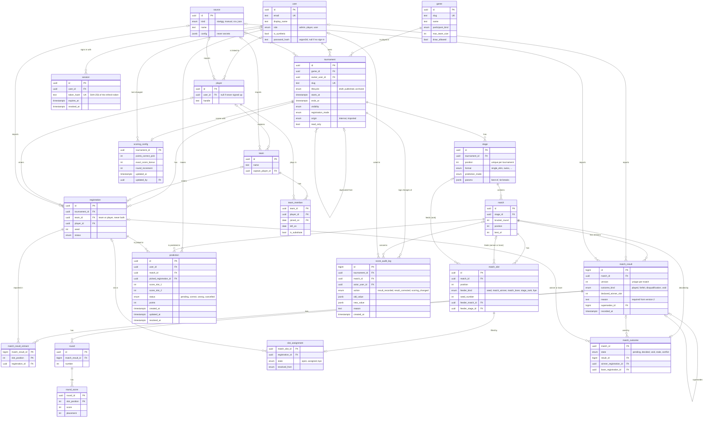

# Database schema

What is actually implemented in PostgreSQL today. The full target design, with every table and the reasons behind it, is in [data-model.md](./data-model.md). This page covers the sprint 2 slice: tournaments, teams, players, registrations, matches and results, with the derived bracket state (ticket #19), plus sign-in sessions (ticket #9). Sprint 3 adds predictions, scoring settings and the score audit log (ticket #56).

- Source of truth: `apps/api/prisma/schema.prisma`
- Migrations: `apps/api/prisma/migrations/`

## Diagram



## Kinds of tables

Every table is one of the kinds defined in [data-model.md, section 3](./data-model.md#3-raw-setup-derived-history).

| Kind | Tables | Who writes |
| --- | --- | --- |
| Setup | `game`, `source`, `user`, `tournament`, `stage`, `team`, `player`, `team_member`, `match`, `match_slot`, `scoring_config` | The API, on organizer actions |
| Raw | `registration`, `match_result`, `match_result_entrant`, `round`, `round_score`, `prediction` (pick and exact score) | The API, on result entry, import or a user's prediction |
| Derived | `slot_assignment`, `match_outcome`, and the outcome columns of `prediction` (`status`, `points`, `resolved_at`) | The recalculation job only |
| History | `score_audit_log` | The API, on each change that moves points; never edited |
| Sessions | `session` | The API, on sign-in, refresh and sign-out (outside the data model kinds) |

A match slot says **where** its participant comes from (seed 3, winner of match 5). Who actually sits there is derived (`slot_assignment`), so correcting a result moves the bracket without touching the setup.

## Rules enforced by the database

These rules live in the migration, not only in the API code:

| Rule | How |
| --- | --- |
| A registration enters a team or a player, never both or neither | `CHECK` constraint `registration_one_participant` |
| Results are never edited: a correction is a new version | Triggers reject `UPDATE` and `DELETE` on `match_result`, `match_result_entrant`, `round`, `round_score` |
| Version 2 and later give a reason and point to the version they replace | `CHECK` constraints on `match_result` |
| Derived tables are only written by the recalculation job | Triggers reject any write unless the transaction ran `SET LOCAL app.recompute = 'on'` |
| One prediction per user and match | Unique index on `prediction (user_id, match_id)` |
| An exact score has both sides, and no score or points is negative | `CHECK` constraints on `prediction` and `scoring_config` |
| A prediction is inserted `pending`; its status, points and resolution date change only in the recalculation | Trigger `guard_prediction_outcome`, same `app.recompute` setting as derived tables |
| The score audit log is never edited or deleted | Trigger `reject_history_mutation` on `score_audit_log` |

Writing derived rows from the job, with Prisma:

```ts
await prisma.$transaction(async (tx) => {
  await tx.$executeRaw`SELECT set_config('app.recompute', 'on', true)`;
  // write slot_assignment and match_outcome here
});
```

## Tournament status

The API shows a `status` of `draft`, `running` or `finished`, but only `lifecycle` is stored: `draft` is a draft, `published` is running until every match has a decided `match_outcome`, then finished, and `archived` is finished. Only a draft can be edited or deleted (ticket #21).

## Bracket generation

`POST /tournaments/:id/bracket` (ticket #23) builds a single-elimination bracket from the tournament's teams and starts the tournament, in one transaction:

1. Seeds go to `registration.seed`: the order set with `PUT /tournaments/:id/seeding` (manual), or a random draw (auto).
2. One `stage` (`single_elim`), one `match` per bracket match, and two `match_slot` rows per match saying where each participant comes from: a seed, a bye, or the winner of an earlier match.
3. The engine (`apps/api/src/engine`) computes layer 1 of the cascade, and the derived `slot_assignment` and `match_outcome` rows are written with `app.recompute` on. A team facing a bye is already through to the next round.

The best seeds meet as late as possible (1 plays 8, 4 plays 5...), and byes go to the top seeds when the number of teams is not a power of two.

## Match results

`POST /matches/:id/result` (ticket #24), admin only, takes `{ "scores": [3, 1], "winnerSlot": 1 }`, scores in slot order. In one transaction:

1. Checks that both teams are known, the match is not a bye, the score is not a tie and the winner has the higher score.
2. Saves the raw result: a `match_result` version with `declared_winner_slot` and `reported_by`, the two teams in `match_result_entrant`, and the score as one `round` with its `round_score` rows.
3. Runs layer 1 again for the whole tournament and replaces its `slot_assignment` and `match_outcome` rows, so the winner fills the next match.

**Corrections** (ticket #27) use the same endpoint with a `reason`, required once the match has a result. The new row is version n+1, with `supersedes_id` pointing to the previous one, which stays: these tables are append-only.

When a correction changes who plays a later match that already has a result, that result names teams that no longer play it. Its `match_outcome` becomes `stale` (section 6.4 of the data model): nobody goes through and the tournament is not finished until an admin corrects that match too. `GET /tournaments/:id/bracket` gives each match its `state`, `hasResult` and `predictionLock`: why it takes no prediction (`bye`, `teams-unknown`, `started` or `played`), null while it is open.

A PostgreSQL advisory lock on the tournament serializes these writes: two results entered at the same time for one match give one `201`, and one `400` asking for a reason, since the match then has a result.

Layer 1 runs inside the request for now, because the bracket is small and nothing else depends on it yet. It moves to the recompute job (section 7 of the data model) with the outbox tables. When the final has a result, every match is decided and the tournament status becomes `finished`.

## Sign-in sessions

Signing in sets two httpOnly cookies. The **access token** is a signed JWT valid 15 minutes, checked without a database read. The **refresh token** is random, valid 7 days, and only its SHA-256 hash is stored in `session`, so a database leak does not expose usable tokens.

- `POST /auth/refresh` replaces the refresh token: the old one stops working at once.
- `POST /auth/logout` and a role change set `revoked_at`, so the session cannot be refreshed any more.
- Passwords are stored as argon2id hashes in `user.password_hash`, never in clear.

## Predictions and scoring

Ticket #56 stores what sprint 3 needs; the endpoints come with #49 to #52.

Endpoints of ticket #49, for any signed-in user whatever their role (anonymous visitors get `401`):

| Endpoint | Does |
| --- | --- |
| `POST /predictions` `{ matchId, teamId, score? }` | Predicts the winner of a match, with an optional exact score in slot order. `409` if the user already predicted it. |
| `PATCH /predictions/:id` `{ teamId?, score? }` | Changes one's own prediction; `score: null` removes the exact score. Someone else's prediction answers `404`, as if it did not exist. |
| `GET /me/predictions?tournament=` | One's own predictions in bracket order, optionally for one tournament (id or slug), each with `locked`. |

A match takes predictions while both its teams are known, it is not a bye, it has no result and its `scheduled_at` has not passed, by the server clock only. Otherwise the answer is `409` with `code: "prediction_locked"` and a `reason`: `started`, `played`, `teams-unknown` or `bye`. An exact score must name a winner, and that winner must be the picked team.

Scoring and resolution, ticket #50:

| Endpoint | Does |
| --- | --- |
| `GET /tournaments/:id/scoring` | The points of the tournament, with `isDefault` while no admin set them. Public, with the same visibility as the tournament. |
| `PUT /tournaments/:id/scoring` `{ pointsCorrectPick, exactScoreBonus, roundIncrement }` | Admin only, whole numbers from 0 to 100. Logs a `scoring_changed` entry with the old and new values, then scores every prediction again with the new points. |

The recalculation that runs after a result resolves the predictions in the same transaction as the bracket advance: the result, the bracket and the points are saved together or not at all. For each prediction (`apps/api/src/engine/predictions.ts`):

- the match is decided and the picked team won: `correct`, worth the points of its round, plus the bonus when the exact score was right too;
- the match is decided and the picked team lost: `wrong`, 0 points;
- a correction moved the picked team out of the match: `cancelled`, 0 points;
- otherwise (no result, stale or in conflict): `pending`.

Only predictions whose status or points change are written, so a run that changes nothing writes nothing.

Corrections, ticket #51:

- Only an admin enters or corrects a result (`POST /matches/:id/result`, with a `reason` for a correction). The same transaction recomputes the bracket, the predictions and their points; the ranking is the sum of `prediction.points`.
- Each result entered or corrected adds a `score_audit_log` entry: `result_recorded` or `result_corrected`, the admin, the time, the reason, and the old and new values (`version`, `scores`, `winnerSlot`, team names), copied so the entry stays readable later.
- `BracketRecomputeService.rebuild` forgets every derived value of a tournament (bracket state, prediction outcomes) and computes it again from the setup and raw results only (data model 6.6). The tests check that a chain of results, corrections and scoring changes ends in the same state as this rebuild, and that it repairs damaged derived data.

Leaderboard and live updates, ticket #52 (public, with the same visibility as the tournament):

| Endpoint | Does |
| --- | --- |
| `GET /tournaments/:id/leaderboard?page=1&pageSize=20` | Everyone who predicted, with `rank`, `user` (id and display name only), `points`, `correctPicks` and `predictions`. Ranked by points, then correct picks, then the earliest first prediction; the user id ends any tie, so the order is stable. `total` for paging, `me` for the signed-in user's own row, and the `version`. |
| `GET /tournaments/:id/events` | Server-sent events. `sync` first, then `match-result` (with `matchId`), `bracket` and `leaderboard` right after each result or correction is committed, and `leaderboard` after a scoring change. A comment every 25 s keeps the connection open. While the server stops, open streams end and new ones get a 503: the client opens another later, and the version in `sync` tells it whether to read again. |

The version of a tournament is the id of its latest `score_audit_log` entry, so it is stored and survives a restart. Every event carries it as its id. A client that reconnects sends the last id it received (`Last-Event-ID`, which `EventSource` does by itself); the `sync` event then says `missed: true` when changes happened meanwhile, and the client refetches. The events only say what changed: clients fetch the data with the usual endpoints. They are published in the API process: running several API instances would need a shared channel (PostgreSQL `LISTEN/NOTIFY`, for example).

- `prediction`: a user's pick for a match, one per user and match, with an optional exact score (slot 1, slot 2). The pick is a registration, not a slot, so a correction that changes who plays the match is visible. The user edits it until the match locks; `status`, `points` and `resolved_at` are the outcome, set by the recalculation.
- `scoring_config`: the points of a tournament. A correct pick in round r is worth `points_correct_pick + (r - 1) * round_increment`, plus `exact_score_bonus` for the exact score. Without a row, the defaults apply: 3, 2 and 1. It is removed with a deleted draft.
- `score_audit_log`: who did what that moves points, when, with the old and new values as JSON snapshots and the reason of a correction.

## Demo data

`npm run db:seed -w apps/api` fills the database in `DATABASE_URL` with a demo: the running tournament `/tournaments/coupe-de-demonstration` with 8 teams, 12 synthetic users (`is_synthetic`, no password, addresses in `.test`) who predicted every first-round match, and 2 results already entered, which resolve the predictions on those 2 matches. Everything is fictitious, and a second run does nothing. It goes through the API services (`apps/api/src/seed/demo.ts`), so it follows the same rules as the admin screens.

## Not implemented yet

Left out of the sprint 2 slice, to be added with the tickets that need them:

- Tables: `season`, `pool`, `station`, `source_import`, `source_record`, `dispute`, the Pick'em questions of the data model (`question`, `answer`, `bracket_pick`), leaderboards (sprint 3 computes the ranking from `prediction.points`) and recalculation history (`outbox_event`, `recompute_run`).
- Columns pointing to those tables: `tournament.season_id`, `match.station_id`, `match.pool_id`, `match_slot.feeder_pool_id`, `registration.source_record_id`, `match_result.source_record_id`, `match_result.dispute_id`.
- A separate database role for the API (section 6.7 of the data model). The triggers already block writes to derived tables.

## Changing the schema

1. Edit `apps/api/prisma/schema.prisma`.
2. With the database running (`docker compose up -d db`):
   ```bash
   npm run db:migrate -w apps/api -- --name <what_changed>
   ```
   This writes a new folder in `prisma/migrations/`, applies it locally and regenerates the client.
3. For a rule Prisma cannot express (trigger, `CHECK`), use `-- --create-only`, edit the generated SQL, then run `npm run db:migrate -w apps/api`.
4. Commit the schema and the migration folder together, and update this page.

`docker compose up` applies pending migrations automatically through the `migrate` service, before the API starts.
