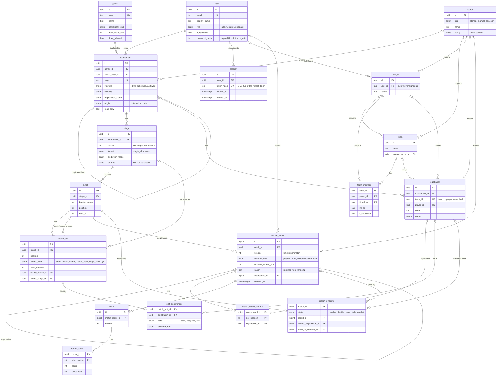

# Database schema

What is actually implemented in PostgreSQL today. The full target design, with every table and the reasons behind it, is in [data-model.md](./data-model.md). This page covers the sprint 2 slice: tournaments, teams, players, registrations, matches and results, with the derived bracket state (ticket #19), plus sign-in sessions (ticket #9).

- Source of truth: `apps/api/prisma/schema.prisma`
- Migrations: `apps/api/prisma/migrations/`

## Diagram



## Kinds of tables

Every table is one of the kinds defined in [data-model.md, section 3](./data-model.md#3-raw-setup-derived-history).

| Kind | Tables | Who writes |
| --- | --- | --- |
| Setup | `game`, `source`, `user`, `tournament`, `stage`, `team`, `player`, `team_member`, `match`, `match_slot` | The API, on organizer actions |
| Raw | `registration`, `match_result`, `match_result_entrant`, `round`, `round_score` | The API, on result entry or import |
| Derived | `slot_assignment`, `match_outcome` | The recalculation job only |
| Sessions | `session` | The API, on sign-in, refresh and sign-out (outside the data model kinds) |

A match slot says **where** its participant comes from (seed 3, winner of match 5). Who actually sits there is derived (`slot_assignment`), so correcting a result moves the bracket without touching the setup.

## Rules enforced by the database

These rules live in the migration, not only in the API code:

| Rule | How |
| --- | --- |
| A registration enters a team or a player, never both or neither | `CHECK` constraint `registration_one_participant` |
| Results are never edited: a correction is a new version | Triggers reject `UPDATE` and `DELETE` on `match_result`, `match_result_entrant`, `round`, `round_score` |
| Version 2 and later give a reason and point to the version they replace | `CHECK` constraints on `match_result` |
| Derived tables are only written by the recalculation job | Triggers reject any write unless the transaction ran `SET LOCAL app.recompute = 'on'` |

Writing derived rows from the job, with Prisma:

```ts
await prisma.$transaction(async (tx) => {
  await tx.$executeRaw`SELECT set_config('app.recompute', 'on', true)`;
  // write slot_assignment and match_outcome here
});
```

## Sign-in sessions

Signing in sets two httpOnly cookies. The **access token** is a signed JWT valid 15 minutes, checked without a database read. The **refresh token** is random, valid 7 days, and only its SHA-256 hash is stored in `session`, so a database leak does not expose usable tokens.

- `POST /auth/refresh` replaces the refresh token: the old one stops working at once.
- `POST /auth/logout` and a role change set `revoked_at`, so the session cannot be refreshed any more.
- Passwords are stored as argon2id hashes in `user.password_hash`, never in clear.

## Not implemented yet

Left out of the sprint 2 slice, to be added with the tickets that need them:

- Tables: `season`, `pool`, `station`, `source_import`, `source_record`, `dispute`, and everything about predictions, leaderboards and recalculation history (`outbox_event`, `recompute_run`).
- Columns pointing to those tables: `tournament.season_id`, `match.station_id`, `match.pool_id`, `match_slot.feeder_pool_id`, `registration.source_record_id`, `match_result.source_record_id`, `match_result.dispute_id`.
- A separate database role for the API (section 6.7 of the data model). The triggers already block writes to derived tables.

## Changing the schema

1. Edit `apps/api/prisma/schema.prisma`.
2. With the database running (`docker compose up -d db`):
   ```bash
   npm run db:migrate -w apps/api -- --name <what_changed>
   ```
   This writes a new folder in `prisma/migrations/`, applies it locally and regenerates the client.
3. For a rule Prisma cannot express (trigger, `CHECK`), use `-- --create-only`, edit the generated SQL, then run `npm run db:migrate -w apps/api`.
4. Commit the schema and the migration folder together, and update this page.

`docker compose up` applies pending migrations automatically through the `migrate` service, before the API starts.
